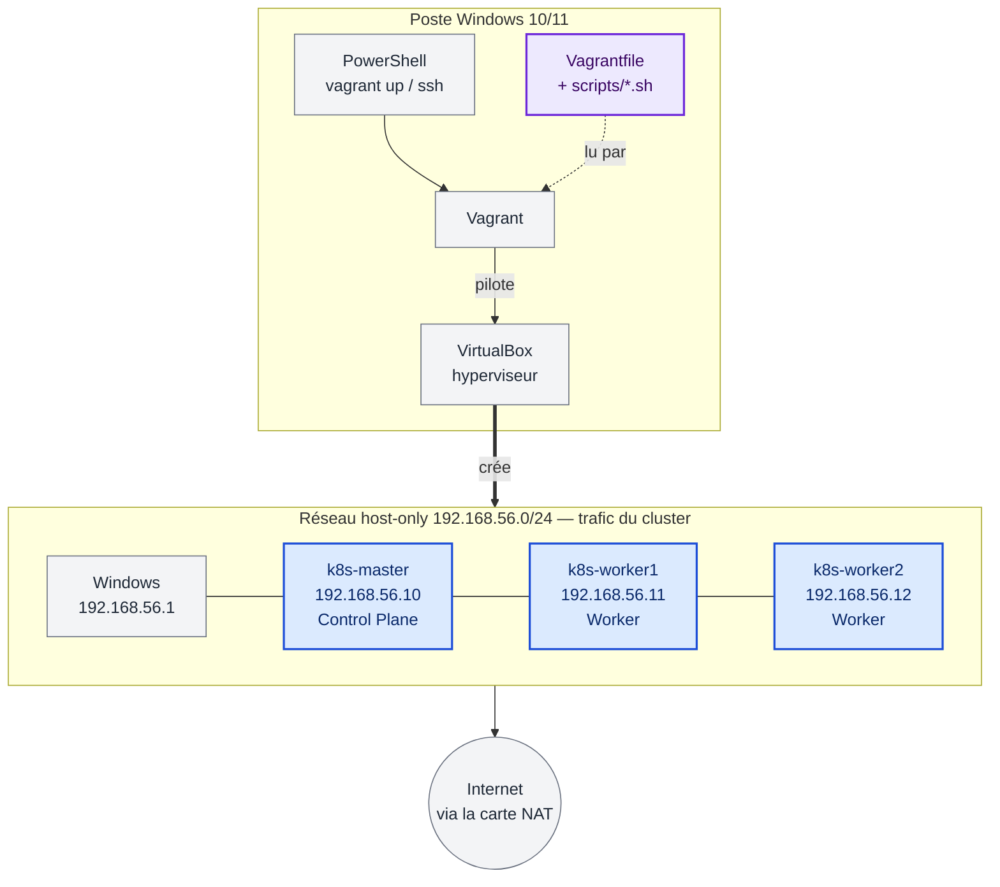
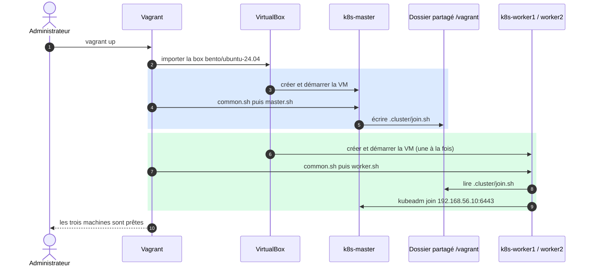
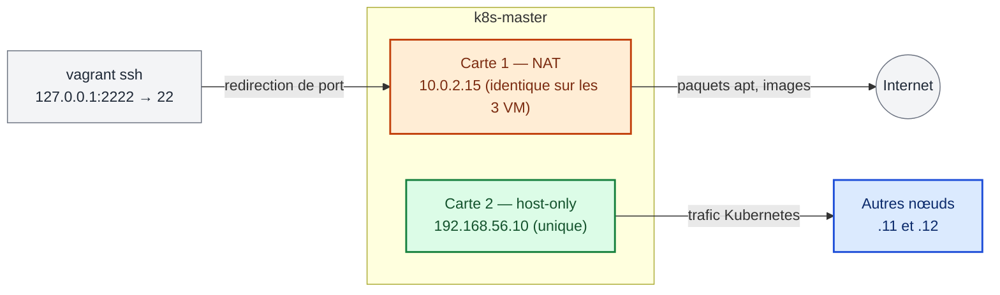
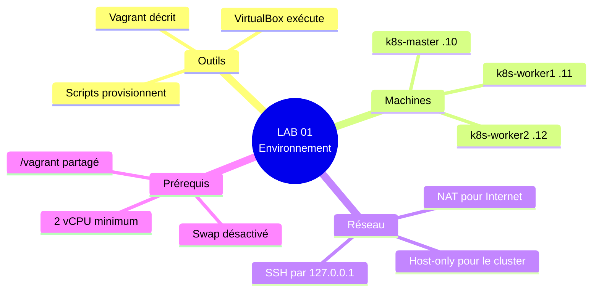

# LAB 01 — Découverte de l'environnement

| | |
|---|---|
| **Durée** | 20 minutes (l'installation se poursuit pendant la pause et le module 4) |
| **Objectifs** | Comprendre le rôle de VirtualBox et de Vagrant · démarrer les trois machines · s'y connecter en SSH · vérifier leurs ressources et leur réseau |
| **Où** | PowerShell sur le poste Windows, puis dans les VM |

## Conventions de tous les labs

- Un bloc `powershell` s'exécute sur le poste Windows, dans le dossier `kubernetes-training`.
- Un bloc `bash` s'exécute sur **k8s-master**, dans le dossier `/vagrant`, sauf mention contraire.
- Le dossier `kubernetes-training` de Windows est visible dans chaque VM sous `/vagrant`. Un fichier modifié d'un côté l'est aussitôt de l'autre : vous pouvez éditer les manifestes avec l'éditeur de votre choix sous Windows.

## Vue d'ensemble en schémas

### Schéma 1 — Architecture du laboratoire



**Lecture du schéma**

| Élément | Explication |
|---|---|
| **Objectif** | Situer chaque outil : qui décrit, qui crée, qui exécute. |
| **Composants** | Le *Vagrantfile* (violet) décrit l'infrastructure ; Vagrant l'interprète ; VirtualBox exécute les trois VM (bleu) qui formeront le cluster. |
| **Relations** | Vagrant ne crée rien lui-même : il pilote VirtualBox par son API, puis lance les scripts de provisionnement dans chaque VM. |
| **Sens des échanges** | PowerShell → Vagrant → VirtualBox → VM. Les VM sortent sur Internet par la carte NAT et se parlent par la carte host-only. |
| **Exemple concret** | `vagrant up` lit le Vagrantfile, demande à VirtualBox de créer `k8s-master`, puis exécute `common.sh` et `master.sh` dans la VM. |
| **Commandes du lab** | `vagrant status`, `vagrant up`, `vagrant ssh k8s-master`, `ip -4 -brief addr`. |

### Schéma 2 — Déroulement de `vagrant up`



**Lecture du schéma**

| Élément | Explication |
|---|---|
| **Objectif** | Montrer pourquoi l'ordre de création compte. |
| **Composants** | Vagrant orchestre ; VirtualBox crée ; le dossier partagé `/vagrant` sert de « boîte aux lettres » entre les VM. |
| **Relations** | Le Worker dépend d'un fichier (`join.sh`) produit par le Control Plane : il ne peut pas être provisionné avant lui. |
| **Sens des échanges** | Le master **écrit** dans `/vagrant/.cluster`, les Workers y **lisent**, puis contactent le master sur le port 6443. |
| **Exemple concret** | Avec `VAGRANT_NO_PARALLEL`, `k8s-worker1` n'est créée qu'une fois `master.sh` terminé. |
| **Commandes du lab** | Repérez les lignes `[common]`, `[master]`, `[worker]` dans la sortie de `vagrant up`. |

### Schéma 3 — Deux cartes réseau, deux usages



**Lecture du schéma**

| Élément | Explication |
|---|---|
| **Objectif** | Comprendre la notion la plus piégeuse de l'environnement : la double carte réseau. |
| **Composants** | La carte NAT (orange : à ne jamais utiliser pour Kubernetes) et la carte host-only (vert : celle du cluster). |
| **Relations** | La NAT donne l'accès à Internet et porte la redirection SSH ; la host-only relie les VM entre elles et au poste Windows. |
| **Sens des échanges** | Sortant vers Internet par la NAT ; dans les deux sens entre nœuds par la host-only. |
| **Exemple concret** | Si le kubelet s'annonçait avec 10.0.2.15, les trois nœuds auraient la même adresse : c'est pourquoi `--node-ip` est forcé (LAB 02). |
| **Commandes du lab** | `ip -4 -brief addr`, `ping -c 2 pkgs.k8s.io`, `vagrant ssh-config k8s-master`. |

<!-- FORMATEUR:DEBUT -->
<details>
<summary><b>🎓 NOTES FORMATEUR</b> — Animation du LAB : vue d'ensemble <i>(réservé à l'animateur, absent de la version participant)</i></summary>

<br>

> 🎤 **Introduction orale**
> « Avant d'orchestrer des conteneurs, il nous faut des machines. Nous n'allons pas cliquer dans VirtualBox : nous allons *décrire* notre infrastructure dans un fichier et laisser un outil la construire. C'est déjà de l'Infrastructure as Code, le même état d'esprit que les manifestes Kubernetes que vous écrirez cet après-midi. »
>
> 🧩 **Analogie**
> Le Vagrantfile est un **plan d'architecte**, VirtualBox est l'**entreprise de construction**, les scripts de provisionnement sont les **corps de métier** qui interviennent dans l'ordre (gros œuvre `common.sh`, puis aménagement `master.sh` / `worker.sh`). On peut démolir et reconstruire la maison à l'identique autant de fois qu'on veut.
>
> 🖥️ **Démonstration en direct (5 min, avant que les participants lancent `vagrant up`)**
> 1. Ouvrir le Vagrantfile au vidéoprojecteur, montrer la boucle sur les trois machines et les deux lignes `provision`.
> 2. Lancer `vagrant up` sur le poste formateur **en premier** : vous aurez un cluster prêt avant tout le monde pour les démonstrations des modules 4 et 5.
> 3. Ouvrir la console VirtualBox côte à côte pour montrer l'apparition des VM.
>
> 🔗 **Liens avec les notions précédentes**
> Module 1 (conteneurs) : une VM virtualise du matériel et embarque un noyau ; un conteneur partage le noyau de l'hôte. Ici, les conteneurs tourneront *dans* des VM : deux niveaux d'isolation à ne pas confondre.
>
> ⏱️ **Gestion du temps**
> `vagrant up` dure 15 à 25 minutes : lancez-le **dès le début** du lab et faites la Partie A pendant le téléchargement de la box. Le module 4 se déroule pendant la fin du provisionnement. Repérez immédiatement les postes à 8 Go (profil `mini`) et ceux où la virtualisation n'est pas activée : ce sont eux qui prendront du retard.

</details>
<!-- FORMATEUR:FIN -->

## Partie A — Lire le Vagrantfile avant de l'exécuter

<!-- FORMATEUR:DEBUT -->
<details>
<summary><b>🎓 NOTES FORMATEUR</b> — Partie A — Lire le Vagrantfile avant de l'exécuter <i>(réservé à l'animateur, absent de la version participant)</i></summary>

<br>

> 🎤 **Introduction orale** — « On ne lance jamais un script d'infrastructure sans l'avoir lu. Prenez cinq minutes pour comprendre ce que `vagrant up` va faire sur votre poste. »
>
> 🔬 **À approfondir à l'oral**
> - La box `bento/ubuntu-24.04` : image de base préparée (Guest Additions incluses), téléchargée une seule fois puis mise en cache dans `~/.vagrant.d/boxes`.
> - Le provisionnement `shell` s'exécute en root dans la VM, **une seule fois** (relancer avec `vagrant provision`).
> - L'ordre des provisionneurs dans le fichier est l'ordre d'exécution.
>
> ❓ **Questions aux participants**
> - « Si je change l'adresse IP dans le Vagrantfile après `vagrant up`, que se passe-t-il ? » *(rien tant qu'on ne fait pas `vagrant reload` ; et le certificat de l'API Server, émis pour l'ancienne adresse, devient invalide)*
> - « Pourquoi ne pas tout mettre dans un seul script ? » *(séparation des rôles : la préparation est commune, l'initialisation et la jointure sont spécifiques)*

</details>
<!-- FORMATEUR:FIN -->

Ouvrez `Vagrantfile` dans un éditeur et répondez :

1. Quelle box est utilisée ? De quel système s'agit-il ?
2. Quelles sont les adresses des trois machines ?
3. Quels scripts sont exécutés sur le Control Plane ? Sur un Worker ?
4. À quoi sert `ENV["VAGRANT_NO_PARALLEL"]` ?

## Partie B — Démarrer les machines

<!-- FORMATEUR:DEBUT -->
<details>
<summary><b>🎓 NOTES FORMATEUR</b> — Partie B — Démarrer les machines <i>(réservé à l'animateur, absent de la version participant)</i></summary>

<br>

> 🎤 **Introduction orale** — « Lancez maintenant la construction. Pendant qu'elle tourne, on va observer ce qui se passe plutôt qu'attendre. »
>
> 🔬 **À approfondir à l'oral** — Le profil `mini` réduit la mémoire des VM ; expliquer la règle : 2 vCPU et 2 Go minimum pour le Control Plane (contrôle `kubeadm` de pré-vol).
>
> 🚨 **Erreurs probables**
>
> | Symptôme | Cause | Diagnostic | Correction |
> |---|---|---|---|
> | `VT-x is not available` ou `VERR_VMX_NO_VMX` | Virtualisation désactivée dans le BIOS, ou Hyper-V actif | `systeminfo` → section « Hyper-V » ; Gestionnaire des tâches → Performances → Virtualisation | Activer VT-x/AMD-V ; `bcdedit /set hypervisorlaunchtype off` puis redémarrer si Hyper-V n'est pas nécessaire |
> | VM extrêmement lente, icône tortue dans VirtualBox | VirtualBox fonctionne au-dessus d'Hyper-V (WSL 2, Docker Desktop) | Icône tortue verte en bas de la fenêtre VM | Désactiver Hyper-V pour la formation, ou accepter la lenteur |
> | `A Vagrant environment or target machine is required` | Commande lancée hors du dossier `kubernetes-training` | `ls Vagrantfile` | `cd kubernetes-training` |
> | `Timed out while waiting for the machine to boot` | Poste surchargé, antivirus qui analyse le disque de la VM | `vagrant status`, console VirtualBox | `vagrant reload`, exclure le dossier VirtualBox VMs de l'antivirus |
> | `$'\r': command not found` dans la sortie | Scripts convertis en fins de ligne Windows (copie manuelle, archive retouchée) | `file scripts/common.sh` | Recloner avec `git clone` (le `.gitattributes` force LF) |
> | Erreur de création du réseau host-only | Plage d'adresses refusée par VirtualBox 7 | Message `VBoxManage hostonlyif` | La plage 192.168.56.0/21 est autorisée par défaut ; vérifier `C:\Program Files\Oracle\VirtualBox` et les droits administrateur |
>
> ❓ **Questions aux participants** — « Qui voit les lignes `[common]` ? Qui en est à `[master]` ? » : permet de faire un point d'avancement collectif sans passer à chaque poste.

</details>
<!-- FORMATEUR:FIN -->

```powershell
cd kubernetes-training
vagrant status
vagrant up
```

Sur un poste limité à 8 Go de mémoire, définissez d'abord `$env:K8S_PROFILE = "mini"`.

L'opération dure 15 à 25 minutes. Pendant ce temps, ouvrez la console VirtualBox et observez la création du groupe `kubernetes-training` et de ses VM. Suivez aussi la sortie de `vagrant up` : chaque étape des scripts y est annoncée par une ligne `[common]`, `[master]` ou `[worker]`.

## Partie C — Explorer une machine

<!-- FORMATEUR:DEBUT -->
<details>
<summary><b>🎓 NOTES FORMATEUR</b> — Partie C — Explorer une machine <i>(réservé à l'animateur, absent de la version participant)</i></summary>

<br>

> 🎤 **Introduction orale** — « Votre VM est un serveur Linux comme un autre. Avant d'y installer Kubernetes, on vérifie qu'elle respecte ses prérequis : ressources, réseau, swap. »
>
> 🔬 **À approfondir à l'oral**
> - Le **swap** : le kubelet refuse par défaut un nœud avec swap actif, car la mémoire garantie aux Pods doit être de la mémoire réelle (Kubernetes 1.28+ sait le tolérer via `NodeSwap`, mais ce n'est pas le réglage standard).
> - `/etc/hosts` : chaque VM connaît les autres par leur nom, sans serveur DNS.
> - `/vagrant` est un montage `vboxsf` : modifications instantanées des deux côtés, mais pas de liens symboliques ni de droits Unix fiables.
>
> ❓ **Questions aux participants**
> - « Pourquoi les trois VM ont-elles toutes l'adresse 10.0.2.15 ? » *(chaque VM a son propre réseau NAT privé, isolé des autres)*
> - « Combien de vCPU faut-il au minimum pour un Control Plane ? » *(2, contrôle de pré-vol de kubeadm)*
>
> 🚨 **Erreurs probables**
>
> | Symptôme | Cause | Diagnostic | Correction |
> |---|---|---|---|
> | `/vagrant` vide | Guest Additions non chargées ou montage échoué | `mount \| grep vagrant` | `vagrant reload` ; vérifier la version de VirtualBox |
> | `ping pkgs.k8s.io` échoue | Proxy d'entreprise ou DNS bloqué | `resolvectl status`, `curl -I https://pkgs.k8s.io` | Configurer le proxy (`http_proxy`) ou passer sur un partage de connexion |
> | `swapon --show` affiche une ligne | Provisionnement interrompu avant l'étape swap | `cat /etc/fstab` | `vagrant provision k8s-master` |

</details>
<!-- FORMATEUR:FIN -->

Dès que k8s-master est créée, ouvrez une **seconde** fenêtre PowerShell :

```powershell
cd kubernetes-training
vagrant ssh k8s-master
```

Dans la VM :

```bash
hostname
cat /etc/os-release | head -3
nproc                      # nombre de vCPU
free -h                    # mémoire
df -h /                    # disque
ip -4 -brief addr          # cartes réseau
cat /etc/hosts
swapon --show              # ne doit rien afficher
ls /vagrant
```

Questions :

1. Combien de cartes réseau la VM possède-t-elle ? Laquelle porte l'adresse `192.168.56.10` ?
2. À quoi sert l'autre carte ? Vérifiez avec `ping -c 2 pkgs.k8s.io`.
3. Pourquoi le swap est-il désactivé ?

Quittez avec `exit`.

## Partie D — Vérifier le réseau depuis Windows

<!-- FORMATEUR:DEBUT -->
<details>
<summary><b>🎓 NOTES FORMATEUR</b> — Partie D — Vérifier le réseau depuis Windows <i>(réservé à l'animateur, absent de la version participant)</i></summary>

<br>

> 🎤 **Introduction orale** — « Le poste Windows doit pouvoir joindre les VM par leur adresse privée : c'est par là que nous atteindrons les applications en NodePort et en Ingress. »
>
> 🔬 **À approfondir à l'oral** — Montrer `vagrant ssh-config` : `HostName 127.0.0.1`, `Port 2222`, clé privée générée par Vagrant. On peut donc se connecter avec n'importe quel client SSH (MobaXterm, VS Code Remote-SSH) en recopiant ces paramètres.
>
> ❓ **Questions aux participants** — « Pour atteindre une application exposée sur le port 30080 du master, quelle adresse taperez-vous dans le navigateur ? » *(http://192.168.56.10:30080, pas 127.0.0.1)*
>
> 🚨 **Erreurs probables**
>
> | Symptôme | Cause | Diagnostic | Correction |
> |---|---|---|---|
> | `ping 192.168.56.10` échoue depuis Windows | Carte host-only absente ou désactivée côté Windows | `ipconfig` → « VirtualBox Host-Only Network » en 192.168.56.1 | Gestionnaire réseau de VirtualBox → recréer la carte, `vagrant reload` |
> | Port SSH 2222 déjà pris | Autre VM Vagrant en cours d'exécution | Message `Fixed port collision` | Normal : Vagrant choisit 2200, 2201… ; toujours passer par `vagrant ssh` |

</details>
<!-- FORMATEUR:FIN -->

```powershell
ping 192.168.56.10
vagrant ssh-config k8s-master
```

`vagrant ssh-config` affiche les paramètres réellement utilisés : la connexion SSH passe par un port redirigé sur `127.0.0.1`, pas par le réseau privé.

Une fois les trois machines créées :

```powershell
vagrant status
vagrant ssh k8s-worker1 -c "hostname; ip -4 -brief addr; ping -c 2 k8s-master"
```

## Aide-mémoire Vagrant

| Commande | Effet |
|---|---|
| `vagrant up` | Crée ou démarre les VM |
| `vagrant status` | État des VM |
| `vagrant ssh <machine>` | Session SSH |
| `vagrant halt` | Arrêt propre, disques conservés |
| `vagrant snapshot save <nom>` | Instantané des VM |
| `vagrant destroy -f` | Suppression définitive |

## Synthèse visuelle

| Notion | Vagrant | VirtualBox |
|---|---|---|
| Rôle | Décrit et automatise l'environnement | Exécute les machines virtuelles |
| Entrée | `Vagrantfile` (Ruby) | Ordres reçus de Vagrant |
| Reproductible | Oui : `destroy` puis `up` recrée tout | Non à lui seul |
| Commandes clés | `up`, `ssh`, `halt`, `snapshot`, `destroy` | Console graphique, `VBoxManage` |

| Carte réseau | Adresse | Usage | Utilisée par Kubernetes ? |
|---|---|---|---|
| Carte 1 — NAT | 10.0.2.15 (identique partout) | Internet, SSH via 127.0.0.1 | ❌ Non |
| Carte 2 — host-only | 192.168.56.10 / .11 / .12 | Trafic entre nœuds, accès depuis Windows | ✅ Oui |

> [!TIP]
> Le soir, arrêtez proprement le laboratoire avec `vagrant halt` : les disques sont conservés et `vagrant up` redémarre le cluster en deux minutes, sans réinstallation.

> [!CAUTION]
> `vagrant destroy -f` supprime définitivement les VM et le cluster. Pour revenir à un état sain, préférez `vagrant snapshot restore propre` (instantané créé au LAB 02).



## Réponses

**Partie A.** 1. `bento/ubuntu-24.04`, Ubuntu Server 24.04 LTS. 2. 192.168.56.10, .11 et .12. 3. `common.sh` puis `master.sh` ; `common.sh` puis `worker.sh`. 4. Elle force la création des VM l'une après l'autre : les Workers ont besoin d'un Control Plane déjà prêt.

**Partie C.** 1. Deux cartes, plus la boucle locale ; la seconde porte l'adresse privée. 2. La première carte, en NAT, donne l'accès à Internet. 3. Le kubelet refuse de démarrer avec du swap actif par défaut : la mémoire réservée aux Pods doit être de la mémoire réelle, sinon les garanties de ressources n'ont plus de sens.
